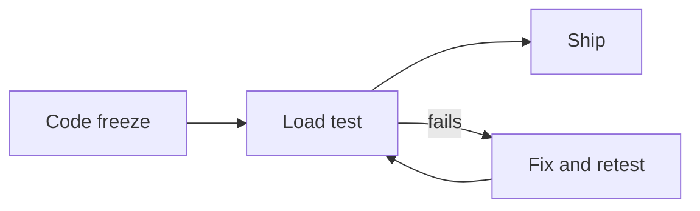

# Launch plan: billing v2

Ship **this Thursday** unless the load test fails. Vote on the day below.

<Stats>
  <Stat label="Beta signups" value="1,284" delta="+18%" />
  <Stat label="Open bugs" value="7" delta="-5" invert />
  <Stat label="p95 checkout" value="420ms" delta="-12%" invert />
</Stats>

<Chart type="area" data="signups.json" x="week" y="signups" height={200} />

## Decide

<Poll id="day" question="When do we launch?" options={["This Thursday", "Next Thursday"]} />

<Approval id="go" title="Go for launch" description="Sign off once your part is ready." approvers={["priya.shah@example.com", "marcus.lee@example.com", "tom.okafor@example.com"]} />

<Checklist id="launch" items={["Docs", "Status page", "Announcement email"]} />

<Comments />
