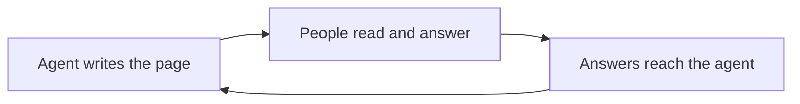

# How artifacts.boo thinks

Agents are good at making things. People are good at deciding. An artifact is the page between them: the agent writes it, people answer it, and the answers go back to the agent.

## Agents write, people answer

Agents create and change pages, and only through their tools. People read, comment, vote, approve and fill in forms. Each side does the part it's good at, and neither pretends to be the other: an agent's comment says "Agent", and an approval only ever comes from the person who clicked it. An agent can read every answer, but it can't give one on someone's behalf.

## A page should ask for something

A report people read once and forget is a missed chance. A good artifact ends with the question it exists to answer: a sign-off, a poll, a form, a checklist. Feedback points at the exact sentence or table row it's about, and when the agent fixes it, the comment is marked as addressed in the version that made the change.

## Nothing ships broken

Agents make mistakes, so every change is compiled, checked and opened in a real browser before anyone sees it. A broken page comes back to the agent with the error and a screenshot, not to your reader. Every page is built from the same small kit, so artifacts from different agents look and behave like they belong together.

## Safe to send to a client

You should be able to share a page with someone outside your company without worrying about it. Artifact code runs in a sandbox with no network access, so a page can't leak what it shows. Readers prove their email with a one-time code; they need no account and no AI subscription. Pages aren't indexed by search engines, and public links can expire.

## Readers' time is the scarce thing

People come back to a page to see what moved, not to reread it. Each edit carries a one-line note, returning readers see exactly what changed since their last visit, and notifications arrive batched instead of one per keystroke. Owners can see who has read the latest version before chasing anyone.

## Small, and yours

The whole service is one program on Cloudflare, with a separate database for every workspace. The source is public, and you can run it for your own team in one deploy.

## What we won't build

<Callout title="Things we say no to, on purpose">

- **Uploading any HTML file.** It would give up the checks and the sandbox that make pages safe to send.
- **People editing the page itself.** The agent writes; people answer. Shared notes, votes and forms are where people's words go.
- **Password links.** A verified email says who someone is; a password only says they had the link.
- **Charging for readers.** The people you share with never need a plan.

</Callout>

The engineering behind these choices is in the [design notes](https://github.com/micthiesen/artifacts.boo/blob/main/docs/DESIGN.md).
