# Diagram gallery

## Block

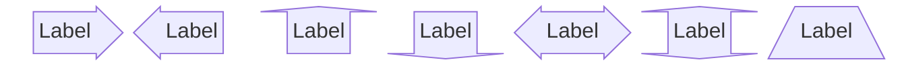

## C4

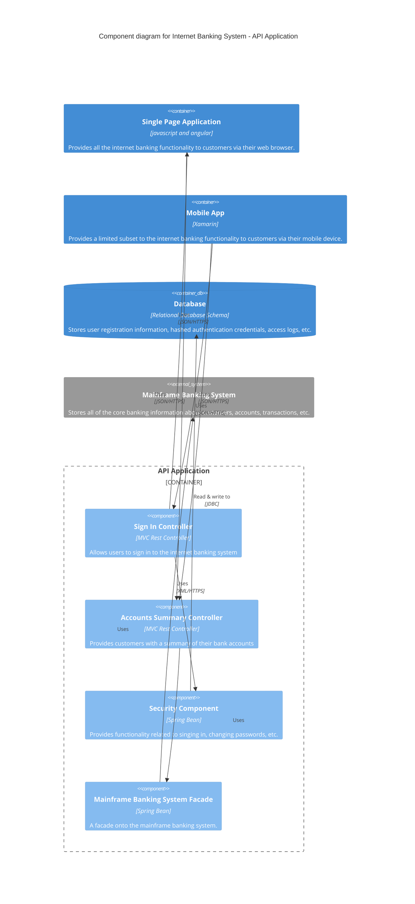

## Class

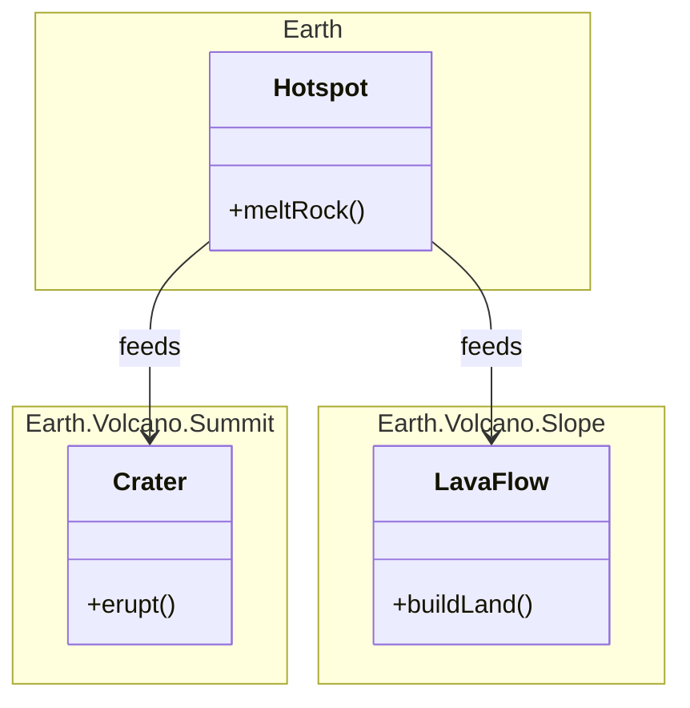

## Entity relationship

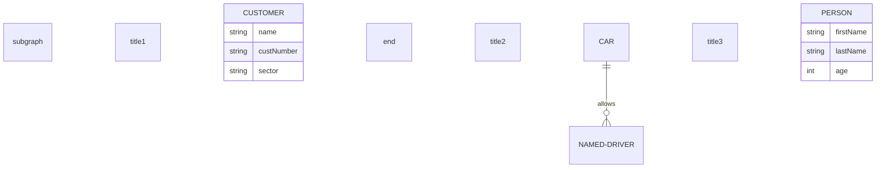

## Event modeling

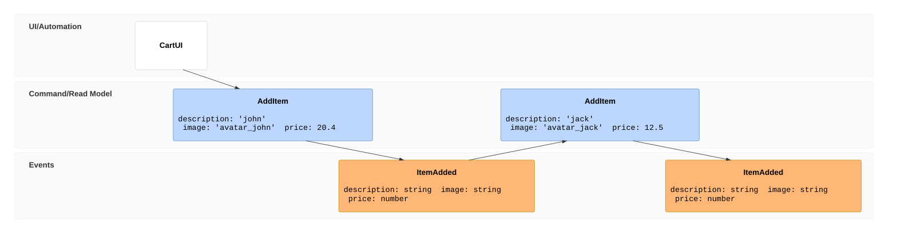

## Flowchart

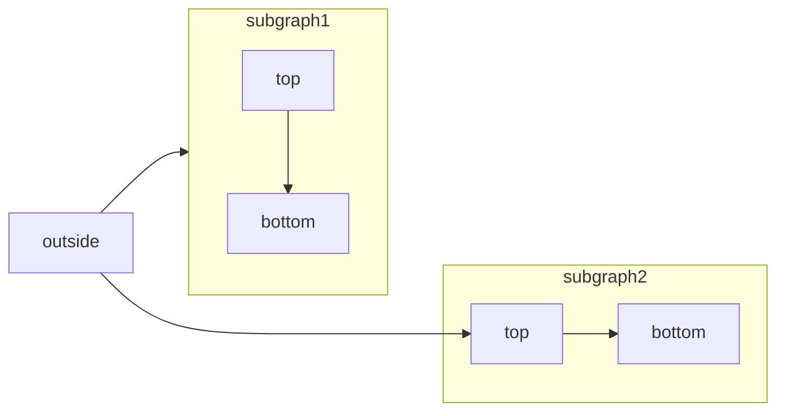

## Gantt

```mermaid
gantt
    title Git Issues - days since last update
    dateFormat X
    axisFormat %s
    section Issue19062
    71   : 0, 71
    section Issue19401
    36   : 0, 36
    section Issue193
    34   : 0, 34
    section Issue7441
    9    : 0, 9
    section Issue1300
    5    : 0, 5
```

## Git graph

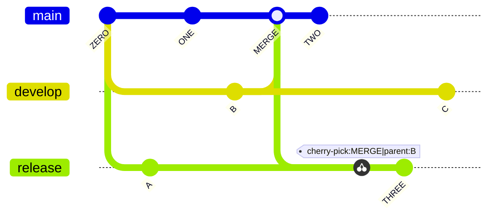

## Kanban

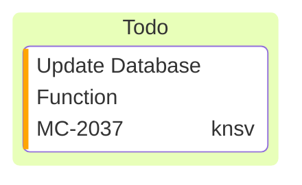

## Mindmap

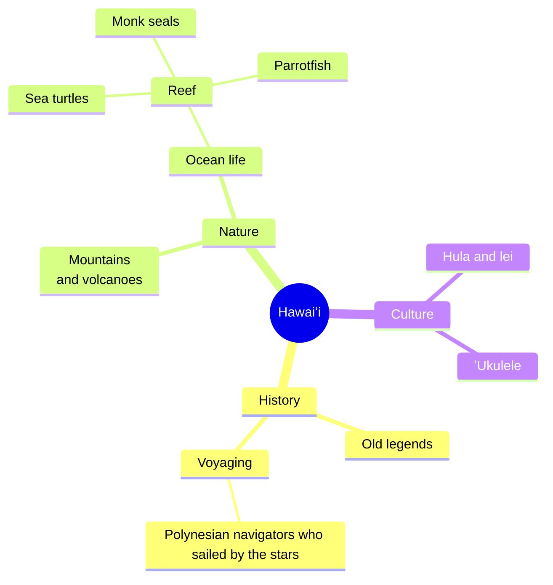

## Packet

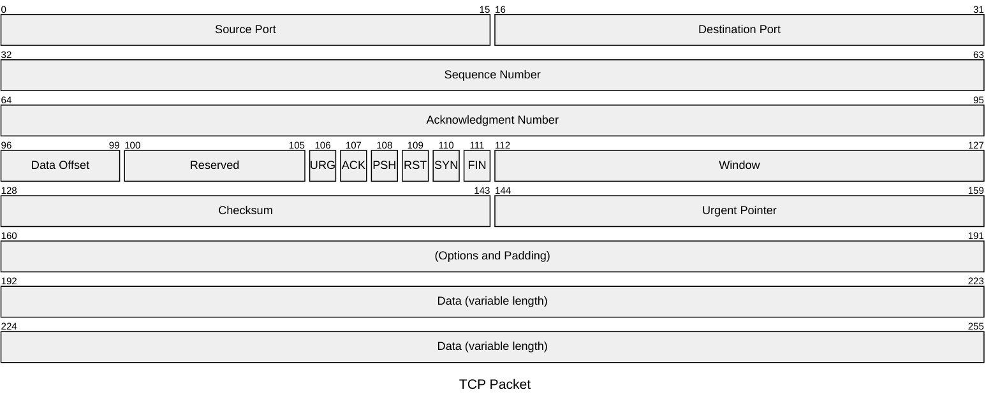

## Quadrant chart

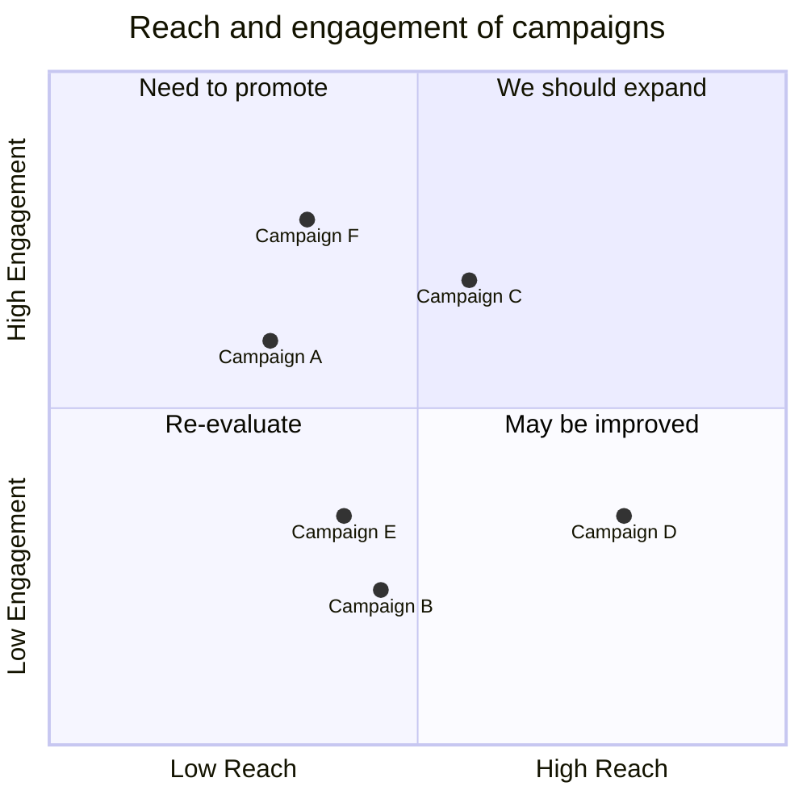

## Requirement

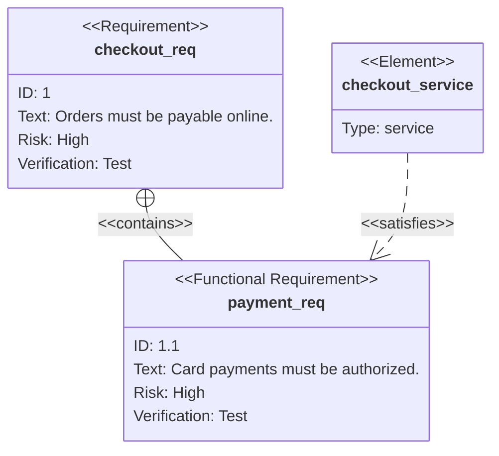

## Sankey

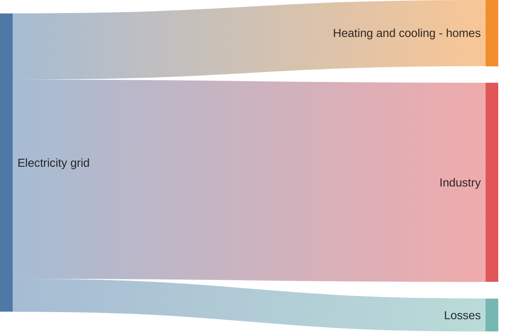

## Sequence

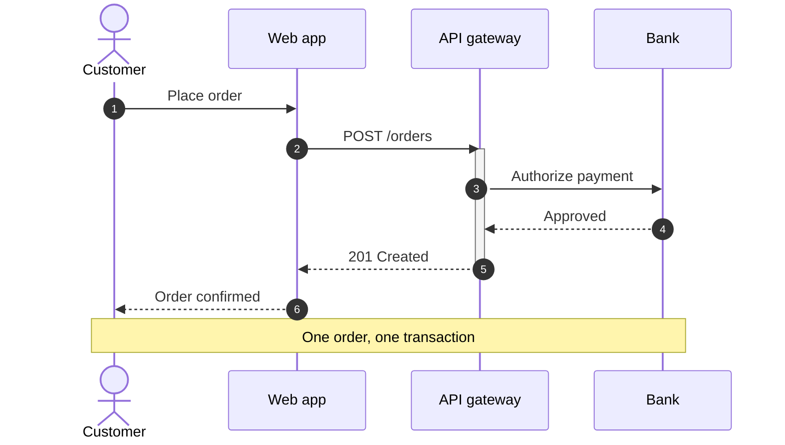

## State

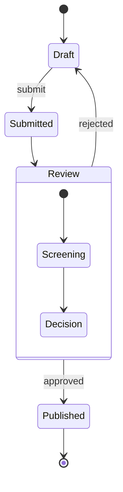

## Timeline

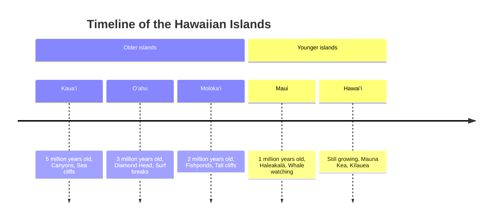

## User journey

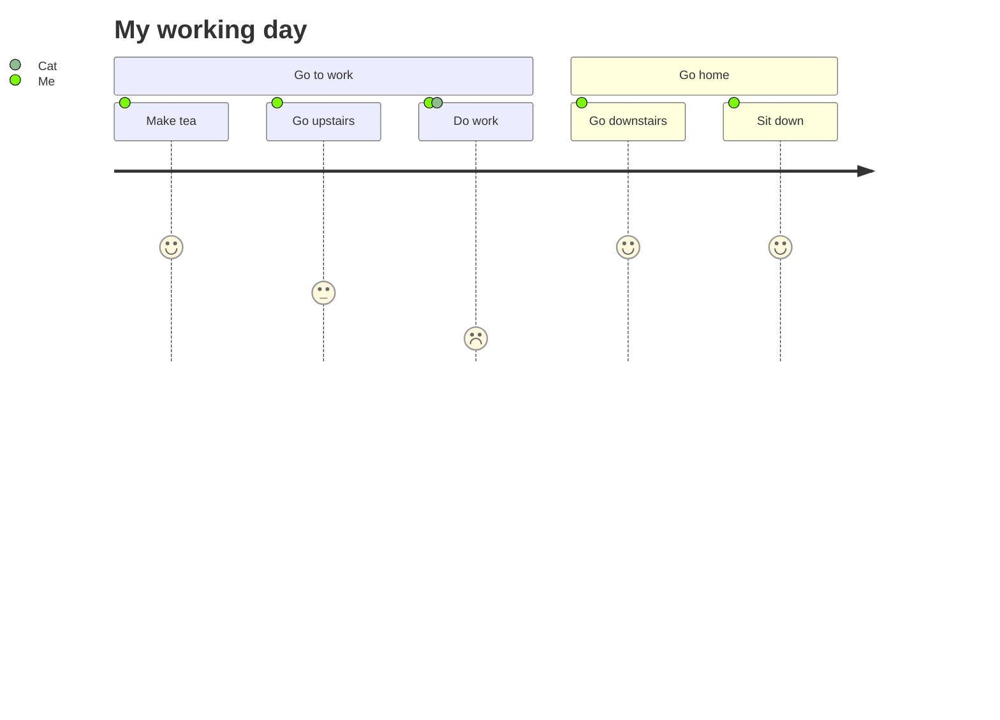

## Agentflow

```mermaid
agentflow-beta TB
  flow intake["Intake"]
    receive["Receive request"]@{ shape: input }
  end

  flow processing["Processing"]
    validate["Validate"]@{ shape: task }
    enrich["Enrich"]@{ shape: task }
    validate --> enrich
  end
  processing@{ view: "collapsed" }

  flow output["Output"]
    publish["Publish"]@{ shape: action }
  end

  receive --> validate
  enrich --> publish
```

## Architecture

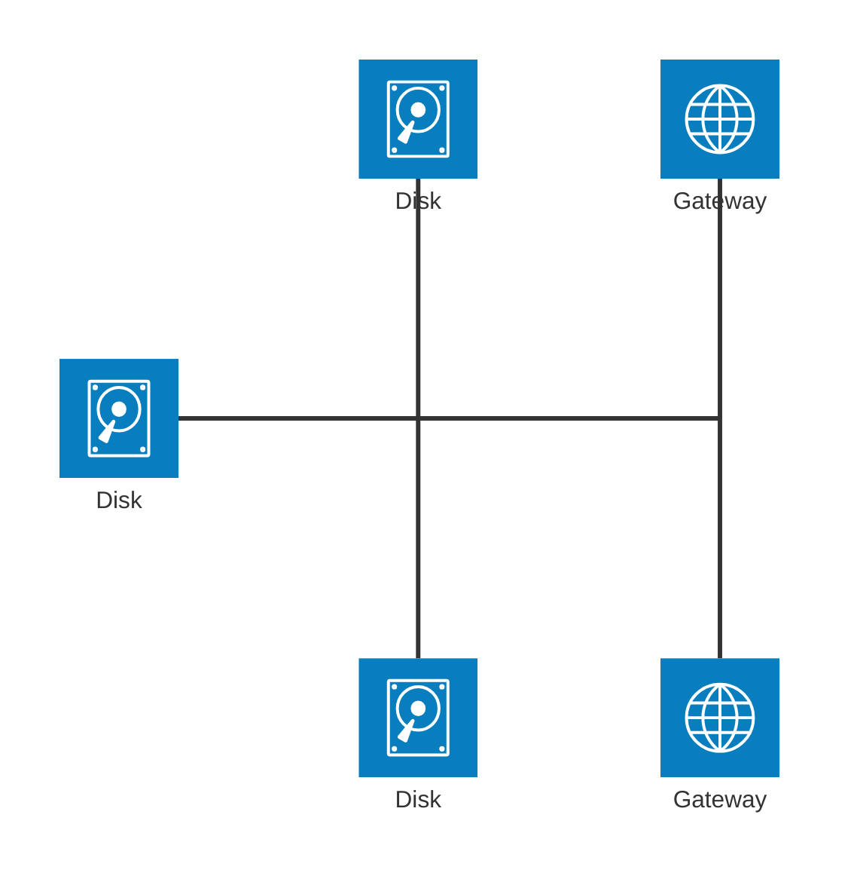

## Cynefin

```mermaid
cynefin-beta
  title Strategy Categorization

  complex
    "Market research"

  complicated
    "Competitive analysis"

  clear
    "Standard pricing"

  chaotic
    "Crisis management"

  complex --> complicated : "Pattern identified"
  complicated --> clear : "Best practice codified"
  clear --> chaotic : "Complacency"
  chaotic --> complex : "Stabilized"
```

## Ishikawa

```mermaid
ishikawa-beta
    Blurry Photo
    Process
        Out of focus
        Shutter speed too slow
        Protective film not removed
        Beautification filter applied
    User
        Shaky hands
    Equipment
        LENS
            Inappropriate lens
            Damaged lens
            Dirty lens
        SENSOR
            Damaged sensor
            Dirty sensor
    Environment
        Subject moved too quickly
        Too dark
```

## Radar

```mermaid
radar-beta
  title Restaurant Comparison
  axis food["Food Quality"], service["Service"], price["Price"]
  axis ambiance["Ambiance"]

  curve a["Restaurant A"]{4, 3, 2, 4}
  curve b["Restaurant B"]{3, 4, 3, 3}
  curve c["Restaurant C"]{2, 3, 4, 2}
  curve d["Restaurant D"]{2, 2, 4, 3}

  graticule polygon
  max 5
```

## Railroad

```mermaid
railroad-ebnf-beta
title "Arithmetic Expression Grammar"

expression = term ( ( "+" | "-" ) term )* ;
term = factor ( ( "*" | "/" ) factor )* ;
factor = number | "(" expression ")" ;
number = digit+ ;
digit = "0" | "1" | "2" | "3" | "4" | "5" | "6" | "7" | "8" | "9" ;
```

## Swimlane

```mermaid
swimlane-beta LR
  subgraph Customer
    request[Request service]
    receive[Receive update]
  end

  subgraph Support
    triage[Triage request]
    answer[Send answer]
  end

  subgraph Engineering
    investigate[Investigate issue]
    fix[Prepare fix]
  end

  request --> triage
  triage -->|Known issue| answer
  triage -->|Needs code change| investigate
  investigate --> fix --> answer
  answer --> receive
```

## Tree view

```mermaid
---
config:
  treeView:
    showIcons: true
    defaultIconPack: material-icon-theme
    filenameIcons:
      Dockerfile: docker
    extensionIcons:
      .ts: typescript
      .tsx: react-ts
      .txt: none
---
treeView-beta
    src/
        App.tsx
        utils.ts
    Dockerfile
    notes.txt
    README.md
```

## Treemap

```mermaid
---
config:
  treemap:
    valueFormat: '$0,0'
---
treemap-beta
"Budget"
    "Operations"
        "Salaries": 700000
        "Equipment": 200000
        "Supplies": 100000
    "Marketing"
        "Advertising": 400000
        "Events": 100000
```

## Use case

```mermaid
---
config:
  usecase:
    actorFontSize: 16
    actorFontFamily: Arial
    actorFontWeight: bold
    usecaseFontSize: 14
    usecaseFontFamily: Georgia
    usecaseFontWeight: normal
    nodeSpacing: 60
    rankSpacing: 70
    diagramPadding: 24
    colorScheme: role
    useMaxWidth: false
---
usecase-beta
direction LR
actor Customer
Browse("Browse catalog")
Customer --> Browse
```

## Venn

```mermaid
---
config:
  theme: default
  look: classic
---
venn-beta
  title What makes a good feature
  set Desirable
  set Feasible
  set Viable
  union Desirable,Feasible["Buildable"]
  union Feasible,Viable["Sustainable"]
  union Desirable,Viable["Marketable"]
  union Desirable,Feasible,Viable["Ship it"]
```

## Wardley map

```mermaid
wardley-beta
title Tea Shop Value Chain

anchor Business [0.95, 0.63]
component Cup of Tea [0.79, 0.61]
component Tea [0.63, 0.81]
component Hot Water [0.52, 0.80]
component Kettle [0.43, 0.35]
component Power [0.10, 0.70]

Business -> Cup of Tea
Cup of Tea -> Tea
Cup of Tea -> Hot Water
Hot Water -> Kettle
Kettle -> Power

evolve Kettle 0.62
evolve Power 0.89

note "Standardizing power allows Kettles to evolve faster" [0.30, 0.49]
```
